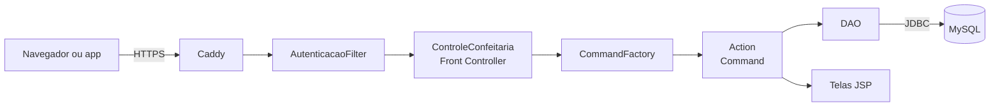

<div align="center">


# Estoque Dejane Cakes

**Controle de insumos, receitas e produção para uma confeitaria artesanal.**


</div>

---

## Sobre o projeto

A Dejane Cakes é uma confeitaria MEI de Mogi das Cruzes (SP) que controlava o estoque e os pedidos em cadernos. Este sistema substitui o controle manual do estoque: mostra o que há em cada insumo, avisa o que está vencendo, diz se cada receita pode ser feita com o estoque atual e desconta os ingredientes automaticamente a cada produção.

O MVP está **em produção desde 23/11/2026**, acessível pelo navegador do computador ou instalado como app no celular.

## Funcionalidades

| Módulo | O que faz |
| --- | --- |
| **Insumos** | Cadastro, busca por nome ou número, edição e exclusão de ingredientes e embalagens, com marca, lote, quantidade decimal, unidade, validade e data da última compra |
| **Receitas** | Ingredientes de cada receita e situação com o estoque atual ("Dá para fazer" ou "N em falta") |
| **Produção** | Desconta todos os ingredientes de uma vez, numa transação: ou tudo, ou nada |
| **Dashboard** | Insumos vencidos, insumos que vencem em até 7 dias e histórico das últimas movimentações |
| **Lixeira** | Itens excluídos ficam 30 dias e podem ser restaurados |
| **Desfazer** | Volta a última alteração de um insumo ou receita |
| **Acesso** | Login com senha protegida por hash e três perfis: dona, administrador e visitante (só leitura) |
| **App (PWA)** | Instalável na tela inicial do celular, com tela própria quando está sem internet |

As regras completas estão em [docs/regras-de-negocio.md](docs/regras-de-negocio.md).

## Tecnologias

- **Back-end:** Java 25, Jakarta Servlet 6.1 e JSP 4.0 no Apache Tomcat 11, JDBC puro, sem frameworks
- **Banco de dados:** MySQL 8.4 (utf8mb4, com regras de integridade no próprio banco)
- **Front-end:** JSP, CSS próprio com as cores da logomarca, PWA (`manifest.json` + service worker)
- **Infraestrutura:** Docker Compose (MySQL + Tomcat + Caddy com HTTPS automático), hospedado na Microsoft Azure
- **Desenvolvimento:** Apache NetBeans (projeto Ant)

## Arquitetura



Aplicação em camadas com os padrões **Front Controller**, **Command**, **Factory**, **DAO** e **Decorator**, seguindo os princípios SOLID. Detalhes, modelo de dados e medidas de segurança em [docs/arquitetura.md](docs/arquitetura.md).

## Começando

### Com Docker (recomendado)

Requisito: [Docker](https://www.docker.com/) com Compose.

```bash
git clone https://github.com/Gabriel-SZ-Silva/estoque-dejane-cakes.git
cd estoque-dejane-cakes
cp .env.exemplo .env    # preencha DOMINIO, senhas e CODIGO_INSTALACAO
docker compose up -d --build
```

Acesse `https://<DOMINIO>` e use **Primeiro acesso** com o `CODIGO_INSTALACAO` do `.env`.

### Com NetBeans

Requisitos: JDK 25, Apache NetBeans, Tomcat 11 e MySQL 8.4. Execute o `banco.sql`, abra a pasta como projeto e rode com F6. Passo a passo em [docs/instalacao-local.md](docs/instalacao-local.md).

## Configuração

Variáveis do arquivo `.env` (modelo em [.env.exemplo](.env.exemplo)):

| Variável | Descrição |
| --- | --- |
| `DOMINIO` | Endereço público do sistema, sem `https://` |
| `DB_SENHA` | Senha do usuário do banco usado pela aplicação |
| `DB_SENHA_ROOT` | Senha do administrador do MySQL |
| `CODIGO_INSTALACAO` | Código exigido para criar a conta principal |

## Estrutura do projeto

```
├── src/java/          código Java (controller, command, factory, dao, model, decorator, filter, util)
├── web/               telas JSP, CSS, imagens, PWA e WEB-INF
├── deploy/            Caddyfile, backup, restauração, gestão de contas e migrações
├── docs/              documentação detalhada
├── banco.sql          criação do banco
├── Dockerfile         build da aplicação
└── docker-compose.yml banco, aplicação e HTTPS
```

## Documentação

| Documento | Conteúdo |
| --- | --- |
| [Regras de negócio](docs/regras-de-negocio.md) | Insumos, receitas, produção, validade, lixeira, desfazer e perfis |
| [Arquitetura](docs/arquitetura.md) | Camadas, padrões de projeto, SOLID, modelo de dados e segurança |
| [Instalação local](docs/instalacao-local.md) | Rodar com Docker ou NetBeans |
| [Publicação](docs/publicacao.md) | Colocar no ar num servidor, atualizar e migrar o banco |
| [Operação](docs/operacao.md) | Contas de usuário, backup, restauração e diagnóstico |
| [Histórico de versões](CHANGELOG.md) | O que mudou em cada versão |

## Próximos passos

- [ ] Registrar no histórico qual usuário fez cada operação
- [ ] Limitar tentativas de login
- [ ] Estorno de produção
- [ ] Módulo de encomendas
- [ ] Testes automatizados

## Equipe

Desenvolvido pela **Equipe SaaSquad**, como projeto acadêmico na Universidade de Mogi das Cruzes (UMC), para a Dejane Cakes.

## Licença

© 2026 Equipe SaaSquad. Todos os direitos reservados. O código está disponível para consulta; uso, cópia ou distribuição dependem de autorização prévia. Veja [LICENSE](LICENSE).
