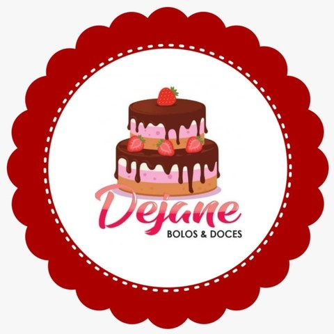
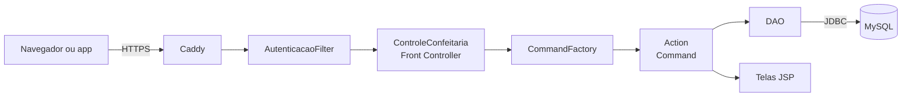
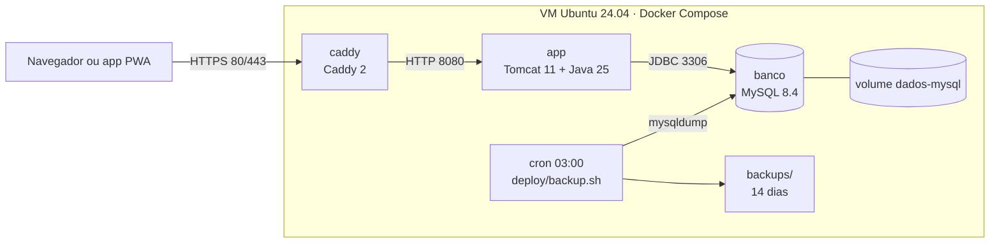

<div align="center">



# Estoque Dejane Cakes

**Controle de insumos, receitas e produção para uma confeitaria artesanal.**

[](https://github.com/Gabriel-SZ-Silva/estoque-dejane-cakes/actions/workflows/build.yml)


[](LICENSE)

</div>

---

## Sumário

- [Sobre o projeto](#sobre-o-projeto)
- [Funcionalidades](#funcionalidades)
- [Tecnologias](#tecnologias)
- [Arquitetura](#arquitetura)
- [Topologia de infraestrutura](#topologia-de-infraestrutura)
- [Começando](#começando)
- [Configuração](#configuração)
- [Estrutura do projeto](#estrutura-do-projeto)
- [Documentação](#documentação)
- [Testes](#testes)
- [Próximos passos](#próximos-passos)
- [Autor](#autor)
- [Contribuidores](#contribuidores)
- [Licença](#licença)

## Sobre o projeto

A Dejane Cakes é uma confeitaria MEI de Mogi das Cruzes (SP) que controlava o estoque e os pedidos em cadernos. Este sistema substitui o controle manual do estoque: mostra o que há em cada insumo, avisa o que está vencendo, diz se cada receita pode ser feita com o estoque atual e desconta os ingredientes automaticamente a cada produção.

O MVP está **em produção desde 23/11/2026**, acessível pelo navegador do computador ou instalado como app no celular. O projeto foi iniciado como trabalho acadêmico na Universidade de Mogi das Cruzes (UMC).

## Funcionalidades

| Módulo | O que faz |
| --- | --- |
| **Insumos** | Cadastro, busca por nome ou número, edição e exclusão de ingredientes e embalagens, com marca, lote, quantidade decimal, unidade, validade e data da última compra |
| **Receitas** | Ingredientes de cada receita e situação com o estoque atual ("Dá para fazer" ou "N em falta") |
| **Produção** | Desconta todos os ingredientes de uma vez, numa transação: ou tudo, ou nada |
| **Dashboard** | Insumos vencidos, insumos que vencem em até 7 dias e histórico das últimas movimentações |
| **Lixeira** | Itens excluídos ficam 30 dias e podem ser restaurados |
| **Desfazer** | Volta a última alteração de um insumo ou receita |
| **Acesso** | Login com senha protegida por hash e três perfis: dona, administrador e visitante (só leitura) |
| **App (PWA)** | Instalável na tela inicial do celular, com tela própria quando está sem internet |

As regras completas estão em [docs/regras-de-negocio.md](docs/regras-de-negocio.md).

## Tecnologias

- **Back-end:** Java 25, Jakarta Servlet 6.1 e JSP 4.0 no Apache Tomcat 11, JDBC puro, sem frameworks
- **Banco de dados:** MySQL 8.4 (utf8mb4, com regras de integridade no próprio banco)
- **Front-end:** JSP, CSS próprio com as cores da logomarca, PWA (`manifest.json` + service worker)
- **Infraestrutura:** Docker Compose (MySQL + Tomcat + Caddy com HTTPS automático), hospedado na Microsoft Azure
- **Desenvolvimento:** Apache NetBeans (projeto Ant)

## Arquitetura



Aplicação em camadas com os padrões **Front Controller**, **Command**, **Factory**, **DAO** e **Decorator**, seguindo os princípios SOLID. Detalhes, modelo de dados e medidas de segurança em [docs/arquitetura.md](docs/arquitetura.md).

## Topologia de infraestrutura

Em produção, o sistema roda numa VM Ubuntu 24.04 da Microsoft Azure (Azure for Students, 1 GB de RAM + 2 GB de swap), com três containers do Docker Compose. Só o Caddy publica portas para a internet; o Tomcat e o MySQL ficam na rede interna do Compose. O endereço é um subdomínio do DuckDNS.



| Serviço | Imagem | Portas | Memória (override) | Dados |
| --- | --- | --- | --- | --- |
| `caddy` | `caddy:2` | 80 e 443, publicadas | 64 MB | Volumes `dados-caddy` e `config-caddy` (certificados) |
| `app` | Build do `Dockerfile` (Tomcat 11, Java 25) | 8080, só na rede interna | 450 MB | Nenhum |
| `banco` | `mysql:8.4` | 3306, só na rede interna | 350 MB | Volume `dados-mysql` |

Os limites de memória vêm do `docker-compose.override.yml`. Detalhes em [docs/publicacao.md](docs/publicacao.md) e [docs/operacao.md](docs/operacao.md).

## Começando

### Com Docker (recomendado)

Requisito: [Docker](https://www.docker.com/) com Compose.

```bash
git clone https://github.com/Gabriel-SZ-Silva/estoque-dejane-cakes.git
cd estoque-dejane-cakes
cp .env.exemplo .env    # preencha DOMINIO, senhas e CODIGO_INSTALACAO
docker compose up -d --build
```

Acesse `https://<DOMINIO>` e use **Primeiro acesso** com o `CODIGO_INSTALACAO` do `.env`.

### Atalhos com make

Em Linux e macOS, o `Makefile` encurta os comandos mais usados. No Windows, ou sem `make`, use os comandos da segunda coluna.

| Atalho | Comando | O que faz |
| --- | --- | --- |
| `make build` | `docker build -t estoque-dejane-cakes .` | Compila a aplicação, como o workflow Build |
| `make up` | `docker compose up -d --build` | Sobe banco, app e Caddy (exige o `.env` preenchido) |
| `make down` | `docker compose down` | Para os containers e mantém os dados do banco |
| `make logs` | `docker compose logs -f --tail=100` | Acompanha os logs (`make logs SERVICO=app` para um serviço só) |
| `make ps` | `docker compose ps` | Mostra a situação dos containers |
| `make backup` | `bash deploy/backup.sh` | Gera uma cópia do banco em `backups/` |

`make` sem alvo lista os atalhos. Nenhum deles apaga o volume do banco.

### Com NetBeans

Requisitos: JDK 25, Apache NetBeans, Tomcat 11 e MySQL 8.4. Execute o `banco.sql`, abra a pasta como projeto e rode com F6. Passo a passo em [docs/instalacao-local.md](docs/instalacao-local.md).

## Configuração

Variáveis do arquivo `.env` (modelo em [.env.exemplo](.env.exemplo)):

| Variável | Descrição |
| --- | --- |
| `DOMINIO` | Endereço público do sistema, sem `https://` |
| `DB_SENHA` | Senha do usuário do banco usado pela aplicação |
| `DB_SENHA_ROOT` | Senha do administrador do MySQL |
| `CODIGO_INSTALACAO` | Código exigido para criar a conta principal |

## Estrutura do projeto

```
├── .github/           workflow Build e modelos de pull request e de issue
├── src/java/          código Java (controller, command, factory, dao, model, decorator, filter, util)
├── web/               telas JSP, CSS, imagens, PWA e WEB-INF
├── deploy/            Caddyfile, backup, restauração, gestão de contas e migrações
├── docs/              documentação detalhada (índice em docs/README.md)
├── banco.sql          criação do banco
├── Dockerfile         build da aplicação
├── docker-compose.yml banco, aplicação e HTTPS
├── Makefile           atalhos para os comandos do Docker Compose
└── CONTRIBUTING.md    como contribuir
```

## Documentação

O índice completo está em [docs/README.md](docs/README.md).

| Documento | Conteúdo |
| --- | --- |
| [Regras de negócio](docs/regras-de-negocio.md) | Insumos, receitas, produção, validade, lixeira, desfazer e perfis |
| [Arquitetura](docs/arquitetura.md) | Camadas, padrões de projeto, SOLID, modelo de dados e segurança |
| [Instalação local](docs/instalacao-local.md) | Rodar com Docker ou NetBeans |
| [Publicação](docs/publicacao.md) | Colocar no ar num servidor, atualizar e migrar o banco |
| [Operação](docs/operacao.md) | Contas de usuário, backup, restauração e diagnóstico |
| [Histórico de versões](CHANGELOG.md) | O que mudou em cada versão |

## Testes

Ainda não há testes automatizados. O workflow **Build** compila a aplicação com `docker build .` a cada envio para a `main` e em cada pull request (localmente: `make build`).

## Próximos passos

- [ ] Registrar no histórico qual usuário fez cada operação
- [ ] Limitar tentativas de login
- [ ] Estorno de produção
- [ ] Módulo de encomendas
- [ ] Testes automatizados

## Autor

**Gabriel Souza Silva**, autor e mantenedor.

- GitHub: [Gabriel-SZ-Silva](https://github.com/Gabriel-SZ-Silva)
- LinkedIn: [gabriel-souza-silva-6689a93b6](https://www.linkedin.com/in/gabriel-souza-silva-6689a93b6)

## Contribuidores

| Nome | GitHub |
| --- | --- |
| Fernando Gabriel | [BinnBingus](https://github.com/BinnBingus) |
| Danilo dos Santos Lopes | [lopes-danilo](https://github.com/lopes-danilo) |

O projeto aceita contribuições por pull request. Cada colaborador trabalha numa branch própria, abre um pull request para a `main` e o mantenedor revisa antes de integrar. As contribuições de cada pessoa aparecem nos pull requests aceitos e na [página de contribuidores](https://github.com/Gabriel-SZ-Silva/estoque-dejane-cakes/graphs/contributors) do GitHub. Para contribuir, leia o [CONTRIBUTING.md](CONTRIBUTING.md).

## Licença

Distribuído sob a licença MIT. Veja [LICENSE](LICENSE).

Não estão cobertos pela licença MIT (detalhes em [NOTICE](NOTICE)):

- o MySQL Connector/J incluído em `web/WEB-INF/lib`, distribuído pela Oracle sob licença própria (GPLv2 com a exceção para software livre e de código aberto);
- a marca e a logomarca "Dejane Cakes" (`web/img/logo.jpg` e os ícones do app), que pertencem à sua titular.
