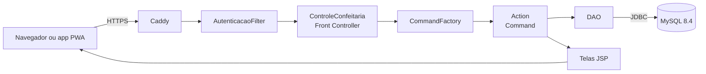
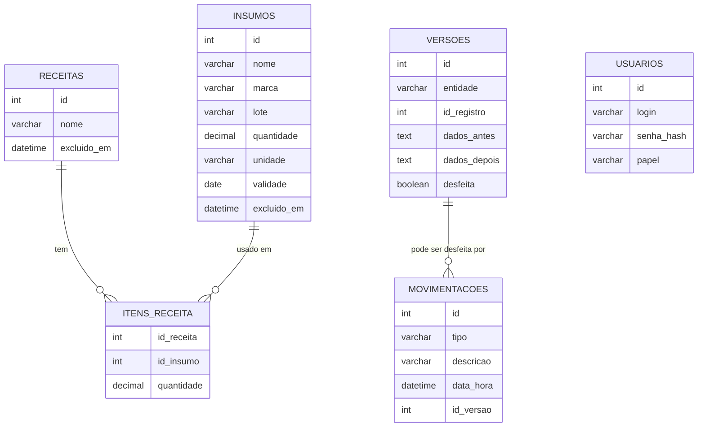

# Arquitetura

O sistema é uma aplicação web Java em camadas, sem frameworks, seguindo os padrões do projeto de referência da disciplina (`SistemaPizzaria`).

## Caminho de uma requisição

1. **`AutenticacaoFilter`** barra qualquer tela sem login (exceto login, primeiro acesso, página de erro e arquivos estáticos), bloqueia ações de alteração para contas `VISITANTE`, envia `Cache-Control: no-store` nas telas com dados e repassa avisos da sessão para a tela seguinte.
2. **`ControleConfeitaria`** é o único servlet. Lê `acao` e `entidade` (só letras) e exige POST para ações que gravam (`Cadastra`, `Atualiza`, `Deleta`, `Produz`, `Restaura`, `Desfaz`, `Entra`).
3. **`CommandFactory`** cria, por reflexão, a classe `command.<acao><entidade>Action`. Exemplo: `acao=Cadastra&entidade=Insumo` → `CadastraInsumoAction`.
4. A **Action** aplica as regras e devolve o nome de uma JSP (forward) ou `redirect:<destino>`.
5. Os **DAOs** concentram o SQL, sempre com `PreparedStatement`, e usam transações onde há várias gravações.

## Pacotes

| Pacote | Responsabilidade | Classes |
| --- | --- | --- |
| `controller` | Front Controller | `ControleConfeitaria` |
| `filter` | Acesso, permissões e cabeçalhos | `AutenticacaoFilter` |
| `factory` | Criação de objetos | `CommandFactory`, `MaterialFactory` |
| `command` | Uma operação por classe | `ICommand` e 21 classes `*Action` |
| `dao` | Acesso ao banco | `InsumoDAO`, `ReceitaDAO`, `MovimentacaoDAO`, `VersaoDAO`, `UsuarioDAO` |
| `model` | Dados | `Insumo`, `Receita`, `ItemReceita`, `Movimentacao`, `Versao`, `Usuario` |
| `decorator` | Tipo do insumo | `Material`, `MaterialBasico`, `MaterialDecorator`, `TipoIngrediente`, `TipoEmbalagem` |
| `util` | Apoio | `FabricaConexao`, `Parametro`, `ValidacaoInsumo`, `Unidade`, `Senha`, `Aviso`, `Foto`, `Html` |
| `ferramentas` | Uso pelo terminal do servidor | `Usuarios` (chamada por `deploy/usuarios.sh`) |

Telas (`web/`): `index.html`, `login.jsp`, `primeiroAcesso.jsp`, `dashboard.jsp`, `consultaInsumos.jsp`, `formCadastrarInsumo.jsp`, `formEditarInsumo.jsp`, `consultaReceitas.jsp`, `formCadastrarReceita.jsp`, `detalheReceita.jsp`, `lixeira.jsp`, `feedback.jsp`, `erro.jsp` e `offline.html`.

## Padrões de projeto

| Padrão | Onde | Para que serve |
| --- | --- | --- |
| Front Controller | `ControleConfeitaria` | Uma única entrada para todas as operações |
| Command | `ICommand` + `*Action` | Cada operação isolada; as edições guardam o necessário para serem desfeitas |
| Factory | `CommandFactory`, `MaterialFactory` | O controlador não conhece as classes concretas |
| DAO | `*DAO` | SQL fora das regras de negócio |
| Decorator | `MaterialBasico` + `TipoIngrediente` / `TipoEmbalagem` | Um tipo novo de insumo é só uma classe nova e uma linha na `MaterialFactory` |

## SOLID

- **Responsabilidade única:** o controlador só encaminha, cada Action trata uma operação, cada DAO cuida de uma tabela e as JSPs só exibem.
- **Aberto/fechado:** uma operação nova é uma classe nova em `command`; o controlador e a fábrica não mudam.
- **Substituição de Liskov:** qualquer `ICommand` serve ao controlador, e qualquer `Material`, decorado ou não, serve às Actions.
- **Segregação de interfaces:** `ICommand` e `Material` têm um método cada.
- **Inversão de dependência:** o controlador depende da interface `ICommand`, não das classes concretas.

## Modelo de dados

O `banco.sql` cria o banco `dejane_cakes_db` (MySQL 8.4, `utf8mb4_0900_ai_ci`).

- Unicidade entre ativos: `UNIQUE (nome, marca, lote, ativo)` em `insumos` e `UNIQUE (nome, ativo)` em `receitas`, com `ativo` como coluna gerada.
- `CHECK` de quantidade ≥ 0 nos insumos e > 0 nos itens de receita.
- Apagar uma receita apaga os itens (`ON DELETE CASCADE`); apagar um insumo usado em receita é barrado pela chave estrangeira.

## Segurança

| Área | Medida |
| --- | --- |
| Senhas | Hash PBKDF2-SHA256 com sal aleatório e 600.000 iterações (`util/Senha`) |
| Login | Mesma resposta e mesmo tempo para usuário inexistente e senha errada; sessão trocada a cada login |
| Sessão | Expira após 12 horas sem uso; cookie `SameSite=Lax` (`web/META-INF/context.xml`) |
| Gravações | Só por POST |
| Entradas | SQL parametrizado; texto escapado antes de exibir (`util/Html`) |
| Navegador | `Cache-Control: no-store` nas telas com dados |
| Conexão | HTTPS com certificado Let's Encrypt renovado pelo Caddy |

Em aberto: não há limite de tentativas de login.
